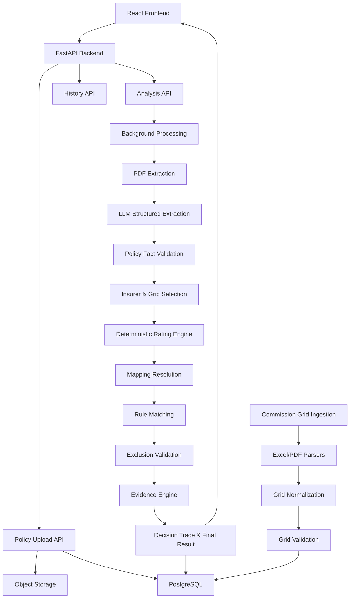

# Insurance Rater Agent

An explainable AI-powered motor insurance brokerage rating system that extracts policy information, identifies applicable insurer commission grids, and determines Own Damage (OD) and Third Party (TP) brokerage percentages with source-level evidence.

## 1. Problem Statement

Motor insurance commission rates are determined using insurer-specific brokerage grids. These grids may contain complex conditions involving:

- Insurer and business type
- Vehicle make and model
- Fuel type and engine capacity (CC)
- Vehicle age and registration location (RTO)
- Geographic zones and vehicle segments
- Policy type and No Claim Bonus (NCB)
- Premium slabs and additional exclusions

These commission grids are commonly distributed as Excel workbooks, PDFs, circulars, and other documents.

Manually identifying the correct commission percentage requires navigating multiple mapping tables, conditional rules, and footnotes.

The Insurance Rater Agent aims to automate this process while maintaining accuracy, reproducibility, and complete decision traceability.

**Core principle:**

> AI extracts and understands policy information. A deterministic rule engine calculates commission rates. An evidence engine explains and validates every decision.

## 2. System Architecture

The application follows a modular monolithic architecture with clearly separated responsibilities.

### High-Level Architecture

## 3. Major System Components

### 3.1 Frontend Application

**Technology:** React + TypeScript

The frontend provides the interface for reviewers to upload motor insurance policies and inspect commission calculations.

Responsibilities:

- Upload motor policy PDFs.
- Display document processing status.
- Display extracted policy information.
- Show OD and TP brokerage percentages.
- Display confidence and resolution status.
- Present step-by-step decision traces.
- Provide source-level citations.
- Maintain access to historical analyses.

### 3.2 Backend Application

**Technology:** Python + FastAPI

FastAPI acts as the central application layer.

Responsibilities:

- Handle policy uploads.
- Expose analysis and history APIs.
- Coordinate document extraction and rating.
- Manage background processing.
- Communicate with PostgreSQL and object storage.
- Return structured analysis results.

### 3.3 Commission Grid Ingestion Pipeline

**Technology:** Python + openpyxl + pandas + PyMuPDF

This component processes insurer-specific commission grid documents and converts them into structured, queryable data.

Pipeline:

1. Identify the source file and insurer.
2. Identify workbook sheets and document structure.
3. Extract tables, cell values, formulas, and footnotes.
4. Identify table headers and conditional dimensions.
5. Normalize insurer-specific structures.
6. Validate mappings, conditions, and rate definitions.
7. Preserve original source references.
8. Store approved grid versions.

The ingestion pipeline maintains two representations:

- **Raw representation:** Original insurer documents and their source structure.
- **Normalized representation:** Structured commission rules and mappings used by the rating engine.

Each normalized rule retains its original file, sheet, row, and cell references.

### 3.4 Policy Extraction Pipeline

**Technology:** PyMuPDF + OCR + LLM structured output + Pydantic

This component extracts relevant information from uploaded motor insurance policy PDFs.

Extraction workflow:

1. Extract text and tables from the PDF.
2. Identify scanned documents and use OCR when required.
3. Provide relevant document content to the LLM.
4. Extract structured policy facts.
5. Validate the extracted fields using Pydantic.
6. Associate extracted facts with their original PDF pages.
7. Persist validated policy information.

Expected extracted fields:

- Current insurer
- Previous insurer
- Business type
- Vehicle make and model
- Fuel type
- RTO
- Engine capacity
- Vehicle manufacture year or age
- Policy type
- NCB percentage
- OD premium
- TP premium

Missing, conflicting, or unreadable information must be explicitly identified rather than assumed.

### 3.5 Deterministic Rating Engine

**Technology:** Python

The rating engine is responsible for determining the applicable brokerage percentages.

Unlike the extraction pipeline, this component does not depend on LLM-generated numerical decisions.

Execution sequence:

1. Identify the applicable insurer.
2. Determine business type.
3. Identify the policy coverage.
4. Select the applicable commission grid version.
5. Resolve RTO-to-zone mappings.
6. Resolve vehicle segment mappings.
7. Identify applicable engine capacity and premium slabs.
8. Evaluate NCB and other required conditions.
9. Apply exclusions and footnotes.
10. Retrieve matching OD and TP commission percentages.

The engine must produce a reproducible result for identical policy facts and identical grid versions.

It must not invent rates when evidence is missing, conflicting, or outside the grid's coverage.

### 3.6 Evidence and Explainability Engine

Every rating decision must be supported by source-level evidence.

The evidence engine records:

- Extracted policy facts and their PDF page references.
- RTO and geographic mapping references.
- Vehicle segment mapping references.
- Matching commission grid conditions.
- Applicable exclusions and footnotes.
- Final OD and TP rate references.

Example:

| Decision | Transformation | Evidence