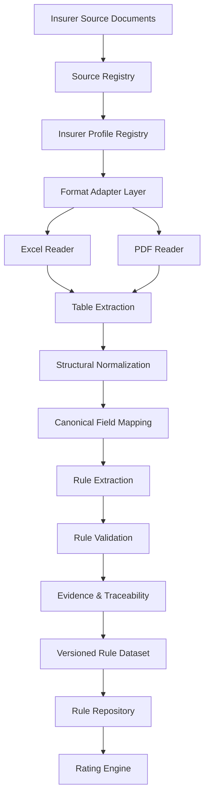

# Insurance Rater — Ingestion Architecture

## 1. Purpose

The ingestion pipeline is responsible for converting insurer-provided rating documents into structured, normalized, traceable and versioned rule datasets that can be consumed by the insurance rating engine.

The system must support different source formats and insurer-specific structures without implementing a separate ingestion engine for every insurer.

### Initial insurer sources

| Insurer | Source | Format |
|---|---|---|
| Go Digit | Large Insurance Brokers Mar'26 - Shared | XLSX |
| Tata AIG | Standard Grid Communication Mar'26 | XLSX |
| Reliance | Broking Premier Feb 2026 | XLSX |
| HDFC ERGO | Private Car grid | PDF |

Each insurer has its own structure, terminology, eligibility conditions and rating criteria. These differences must be handled through source-specific configuration and adapters.

## 2. Architectural principles

1. **Common processing engine:** All insurers use the same core ingestion workflow.
2. **Insurer-specific configuration:** Sheet names, header locations, field mappings and product definitions live inside individual insurer profiles.
3. **Source preservation:** Original values must never be discarded during normalization.
4. **Evidence traceability:** Every extracted rule must retain its original file, sheet or page, row and cell references.
5. **Deterministic processing:** Parsing, mapping and rule generation must be reproducible.
6. **Versioned ingestion:** Every ingestion run must identify the exact source version used.
7. **Safe interpretation:** Unknown markers, ambiguous values and unsupported rules must remain unresolved rather than being guessed.
8. **Format independence:** Excel and PDF documents should eventually produce the same normalized output structure.

## 3. High-level architecture



The ingestion pipeline ends when a validated, versioned rule dataset is published. The runtime rating engine consumes that dataset separately.

## 4. Component responsibilities

### 4.1 Source Registry

Maintains information about insurer source documents.

Responsibilities:
- Identify the insurer.
- Identify the source document and format.
- Maintain source version and effective period where available.
- Track the original filename and checksum.
- Prevent accidental duplicate ingestion.

Example source metadata:

```json
{
  "source_id": "godigit_mar_2026",
  "insurer": "Go Digit",
  "version": "March 2026",
  "file_type": "xlsx",
  "filename": "Large Insurance Brokers Mar'26 - Shared.xlsx"
}
```

### 4.2 Insurer Profile Registry

Each insurer has an independent profile describing how its source documents should be processed.

A profile contains:

- Source metadata.
- Worksheet configurations.
- Header row definitions.
- Data starting rows.
- Product-line definitions.
- Field mappings.
- Source-specific parsing rules.
- Special value interpretation configuration.

Proposed structure:

```text
profiles/
├── godigit/
│   ├── source.py
│   ├── sheet_profiles.py
│   ├── field_mappings.py
│   └── rules.py
│
├── tata_aig/
│   ├── source.py
│   ├── sheet_profiles.py
│   ├── field_mappings.py
│   └── rules.py
│
├── reliance/
│   ├── source.py
│   ├── sheet_profiles.py
│   ├── field_mappings.py
│   └── rules.py
│
└── hdfc_ergo/
    ├── source.py
    ├── document_profiles.py
    ├── field_mappings.py
    └── rules.py
```

The registry should dynamically register available insurer profiles rather than hardcoding insurer-specific processing logic inside the core engine.

### 4.3 Format Adapter Layer

This layer abstracts the differences between file formats.

**Excel adapter**
- Load workbooks.
- Read worksheet metadata.
- Handle merged cells.
- Extract headers and tabular records.
- Preserve cell coordinates.

Technology: `openpyxl`.

**PDF adapter**
- Extract text and tables.
- Identify page boundaries.
- Preserve table and page references.
- Support OCR fallback for scanned documents.

Potential technologies: PyMuPDF, pdfplumber and OCR.

Both adapters should produce a common intermediate table representation.

### 4.4 Table Extraction Layer

Responsible for extracting structured records from source documents.

For Excel:
- Detect configured headers.
- Handle multi-level headers.
- Extract records.
- Preserve original header names.
- Retain source coordinates.

For PDF:
- Detect tables and relevant sections.
- Extract row and column structures.
- Retain page and table references.

The extraction layer should not decide the business meaning of a commission field.

### 4.5 Structural Normalization

Converts extracted source records into a common internal representation.

Example:

```json
{
  "source_id": "godigit_mar_2026",
  "product_line": "commercial_vehicle",
  "table_type": "commission_grid",
  "source_row": 5,
  "fields": {
    "Cluster": {
      "source_header": "Cluster",
      "raw_value": "UP Cluster 1"
    },
    "Segment": {
      "source_header": "Segment",
      "raw_value": "GCV4 upto 1.6T 6+ years"
    }
  }
}
```

Important: Structural normalization does not mean business interpretation. Original headers and values remain available.

### 4.6 Canonical Field Mapping

Maps insurer-specific fields to common application terminology.

Example:

| Insurer source field | Canonical field |
|---|---|
| Cluster | geographic_cluster |
| Segment | vehicle_segment |
| Make | vehicle_make |
| RTO Code | rto_code |
| State | state |
| City | city |
| Note | underwriting_note |

Mappings are configured separately for each insurer.

Unmapped fields must remain preserved. They should not be silently discarded.

### 4.7 Rule Extraction

Converts normalized records into individual rule objects.

A rule contains:

- Unique rule ID.
- Insurer and source version.
- Product line.
- Matching conditions.
- Original rule values.
- Underwriting notes.
- Source evidence.

Example:

```json
{
  "rule_id": "godigit_mar_2026:CV Grid (excl. HCV):5",
  "source_id": "godigit_mar_2026",
  "product_line": "commercial_vehicle",
  "conditions": [
    {
      "field": "geographic_cluster",
      "operator": "equals",
      "value": "UP Cluster 1"
    },
    {
      "field": "vehicle_segment",
      "operator": "equals",
      "value": "GCV4 upto 1.6T 6+ years"
    }
  ],
  "rule_values": [],
  "source_sheet": "CV Grid (excl. HCV)",
  "source_row": 5
}
```

This is a structural example. Actual source values must be retained in `rule_values`.

### 4.8 Rule Validation

Validates the extracted rules before publication.

Validation categories:

**Structural validation**
- Required fields exist.
- Rule IDs are unique.
- Source references are valid.

**Data validation**
- Numeric fields have valid source values.
- Unknown markers are preserved.
- Invalid or missing values are flagged.

**Semantic validation**
- Product-line mappings are consistent.
- Conditions are supported by source definitions.
- Conflicting or duplicate rules are identified.
- Unsupported interpretations are marked unresolved.

Rules that fail validation must not be silently published as usable rating rules.

### 4.9 Evidence and Traceability

Every rule must be traceable to its original source.

For Excel:

```json
{
  "source_file": "Large Insurance Brokers Mar'26 - Shared.xlsx",
  "sheet": "CV Grid (excl. HCV)",
  "row": 5,
  "cells": ["B5", "C5", "D5", "E5", "F5", "G5"]
}
```

For PDF:

```json
{
  "source_file": "HDFC_ERGO_Private_Car.pdf",
  "page": 4,
  "table": 2,
  "row": 7
}
```

The evidence model must support both formats.

### 4.10 Versioned Rule Repository

After successful validation, the pipeline publishes a versioned rule dataset.

The repository should retain:

- Source document metadata.
- Ingestion run ID.
- Extracted and normalized data.
- Validated rules.
- Validation reports.
- Source evidence.
- Processing timestamps.
- Pipeline version.

This makes historical rating decisions reproducible even after an insurer uploads a newer grid.

## 5. Proposed backend directory structure

```text
backend/app/ingestion/
│
├── core/
│   ├── profile_models.py
│   ├── registry.py
│   ├── normalized_models.py
│   ├── mapping_engine.py
│   └── rule_models.py
│
├── profiles/
│   ├── godigit/
│   ├── tata_aig/
│   ├── reliance/
│   └── hdfc_ergo/
│
├── readers/
│   ├── excel_reader.py
│   └── pdf_reader.py
│
├── extractors/
│   ├── table_extractor.py
│   └── pdf_table_extractor.py
│
├── normalizers/
│   └── normalizer.py
│
├── mappers/
│   └── mapping_engine.py
│
├── rules/
│   ├── rule_extractor.py
│   ├── rule_validator.py
│   └── rule_compiler.py
│
├── services/
│   ├── ingestion_service.py
│   └── publication_service.py
│
└── repositories/
    └── rule_repository.py
```

This is the target organization. Existing files can be moved into these directories incrementally; there is no need to rewrite working code just to match the layout.

## 6. End-to-end ingestion workflow

The expected execution sequence:

1. Register the insurer source.
2. Identify the appropriate insurer profile.
3. Load the original document.
4. Select the format adapter.
5. Extract sheets, tables and records.
6. Normalize the extracted structure.
7. Apply canonical field mappings.
8. Compile normalized records into rule objects.
9. Validate the rules and their source evidence.
10. Generate an ingestion report.
11. Publish the validated version.
12. Retain the original source and previous versions.

Example service interface:

```python
result = ingestion_service.ingest(
    source_id="godigit_mar_2026"
)
```

Expected result:

```json
{
  "ingestion_run_id": "run_001",
  "source_id": "godigit_mar_2026",
  "status": "completed",
  "statistics": {
    "sheets_processed": 14,
    "records_extracted": 0,
    "rules_created": 0,
    "rules_validated": 0
  },
  "published_version": "1"
}
```

The counts are placeholders; the actual service must populate them from execution results.

## 7. Technology choices

| Concern | Technology |
|---|---|
| Backend | Python + FastAPI |
| Excel parsing | openpyxl |
| PDF extraction | PyMuPDF + pdfplumber |
| OCR fallback | Tesseract or cloud OCR |
| Data validation | Pydantic |
| Data processing | Python |
| Persistent metadata | PostgreSQL |
| Original document storage | S3-compatible object storage |
| Testing | pytest |

The ingestion system can begin as a modular monolith. Celery and Redis can be introduced when background processing and concurrent ingestion become necessary.

## 8. What is inside and outside ingestion?

**Inside ingestion**
- Insurer grid parsing.
- Data normalization.
- Field mapping.
- Rule compilation.
- RTO and reference mapping extraction.
- Rule validation.
- Version management.
- Source evidence.

**Outside ingestion**
- Policy PDF extraction.
- Customer policy interpretation.
- Runtime rule matching.
- Rule precedence evaluation.
- Commission calculation.
- Final OD/TP brokerage response.

This separation prevents the ingestion system from becoming coupled to individual customer policy requests.

## 9. Implementation milestones

| Milestone | Deliverable |
|---|---|
| 1 | Go Digit ingestion |
| 2 | Tata AIG profile and ingestion |
| 3 | Reliance profile and ingestion |
| 4 | HDFC ERGO PDF adapter and ingestion |
| 5 | Common ingestion orchestrator |
| 6 | Unified validation and evidence |
| 7 | Versioned rule publication |
| 8 | Integration readiness for rating engine |

## 10. Definition of done

The ingestion architecture will be considered complete when:

- All four insurer sources can be ingested.
- Each source uses the common ingestion framework.
- Insurer-specific logic remains isolated in profiles and adapters.
- All supported rules have normalized structures.
- Source evidence is preserved.
- Unsupported and ambiguous records are identified.
- Re-ingestion creates a new version without destroying previous versions.
- The ingestion service can be invoked through one consistent interface.
- The published datasets are consumable by the runtime rating engine.

**Final architectural decision:** We are building a profile-driven, adapter-based ingestion pipeline with a common canonical rule model. The insurer profiles describe the source; the adapters understand the file format; the common engine extracts, normalizes, validates and publishes the resulting rules.